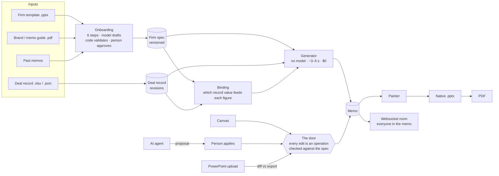

# One memo, every firm

**Investment committee memos that know your firm's format, your deal's numbers and everyone's edits.**

Every investment firm writes committee memos in its own house style: its own PowerPoint master, its own number
formats, its own rules about which sections come first and what can never be touched. Today that knowledge lives
in a brand PDF, a template nobody fully follows, and the heads of the associates who copy last quarter's deck.

This platform learns a firm's format **once**, keeps the deal's figures in a **versioned record**, and builds the
memo from both. People then edit it the way they already work — **in the browser, by asking an AI agent, or in
PowerPoint** — and every edit, from any of the three, is checked against the firm's rules before it lands.
Nothing anyone did is ever silently lost.

> Three firms loaded with very different material — a 16:9 template, a 4:3 template, and a firm that sent **only a
> written guide** — run on the same code. **Zero lines of code name a firm.**

---

## Highlights

| | |
|---|---|
| **A new firm is configuration, not code** | A six-step onboarding turns a firm's template, brand guide and past memos into a versioned spec. The guide-only firm went in with 81 boxes, 57 recipe segments, 55 rules and 38 figures — and no code change. |
| **Native PowerPoint, not a screenshot** | Memos are painted on the firm's own master: real layouts, native tables and charts, footers, logos. A firm with no template gets a master generated from its guide. |
| **PowerPoint is an editor, not an exit** | Download, edit in PowerPoint, upload. Changes come back as checked operations; numbers typed over record figures are refused; whatever cannot apply is kept aside as a visible conflict. |
| **Figures can't drift** | A figure is a piece of text that remembers its path in the deal record. It can be updated, traced, and is protected from typing — everywhere. |
| **AI that proposes, people who apply** | The agent turns "make the title shorter" or "add a customer concentration slide" into operations, validated by the same server rules. It never introduces a number the record doesn't hold and never applies anything on its own. |
| **Live, multi-person editing** | One live room per memo over websockets; everyone sees edits as they happen; stale edits become conflicts, not overwrites. |
| **Text measured in the firm's real fonts** | Long text shrinks to the firm's minimum size for that role, then says "does not fit". Agrees with PowerPoint on 208 of 210 boxes. Text is never cut silently. |

---

## How it works



**Three stores, kept apart.** The **record** holds the facts, the **spec** holds the rules, the **memo** holds
what people did. Each is versioned, so one can change without corrupting the others. A memo is pinned to one spec
version and one record revision until a person moves it — and "See changes" shows exactly what moving will do
before anyone clicks Apply.

**One door.** Canvas, agent and PowerPoint don't write to the memo; they send **operations** ("write this box",
"move this box", "duplicate this slide"). The door checks each one against locked boxes, the free area, the grid,
the palette, section counts and order, and figure protection. A refused edit always says why. Every operation is
logged.

---

## Features

### Firm onboarding
- Six reviewed steps in the app: **materials → house style → structure → layouts → recipe → rules**.
- Each step is one model call with a package code prepares; **code validates the answer and retries with the errors**
  (max two), then a person approves it on screen.
- Where the guide and the template disagree, the conflict is shown with its evidence and a person decides.
- Guide logic that no rule type can express is listed as "unmapped", with its quote — not silently dropped.
- Approved steps are written as a new **spec version** in database tables.

### Deal records and binding
- Records upload from Excel or JSON; every edit or upload is a new revision (full copy, nothing overwritten).
- Binding review flags what needs a person: missing values, broken paths, values that diverged since last upload,
  two figures showing the same value, wrong kind of value.
- A newer record never changes a memo on its own: **See changes** lists every figure before → after; **Apply**
  updates figures only — people's words stay.

### The memo
- Built per stage (e.g. First IC) from the sections that stage requires, every box filled by its recipe:
  figures from the record, `‹model: …›` / `‹person: …›` where text is still to write, `[no data: …]` where the
  record has none.
- **Pendings** (what the memo still needs) are computed from the memo as it is, never stored — they disappear
  when they stop being true. They never block editing or export.

### Editing
- **Canvas:** template slides are locked to the firm's layout; free slides have a free area on the firm's grid for
  text, tables and charts from the record, and pictures. Slides reorder by drag where the firm allows it.
- **Custom slides, three ways in:** upload a PPTX/PDF slide (native where possible, a flagged picture where not),
  build one on the canvas, or ask the agent.
- **Every picture is a pending until confirmed** — it might be a chart pasted as an image.
- **PowerPoint round trip:** one Upload button decides by the file — this memo's export comes back as changes,
  another memo's export is refused, any other deck adds its slides.

### Outputs
- Native PPTX on the firm's master; PDF converted by PowerPoint itself so it reads exactly like the editable file.
- Build + PPTX + PDF in **~9–12 s per memo, $0 model cost**.

---

## Technical decisions and tradeoffs

| Decision | Why | What it costs |
|---|---|---|
| **Relational tables, not slides as JSON documents.** Memo → slide → element → paragraph → segment, plus per-element revisions. | Constraints, history per box, and one element model shared by layouts, the canvas, the painter, the text measure and the agent. | More tables and migrations. Mitigated by reading a whole memo in **one round trip** (~0.3 s for 16 slides against hosted Postgres). |
| **One door for every edit.** | One place to enforce rules, one log of what happened, identical behaviour across canvas, agent and PowerPoint. | Every edit is a server round trip (~0.5 s per box save). Tuned from ~23 round trips to 4 with a compare-and-set on the element's revision. |
| **Optimistic concurrency per box.** An edit made on an older revision is **kept aside** as a conflict. | Nobody's work is overwritten, and nothing disappears — conflicts are visible with their content. | Someone has to resolve conflicts. In testing: eight simultaneous edits on one box → 1 applied, 7 kept aside, 0 lost. |
| **One person per box, not character-level merging (no CRDT).** | Simple, predictable, matches how memo boxes are actually owned. Others see who holds a box and its text live. | Two people can't type in the same box at once. |
| **Onboarding split into six reviewed steps**, not one big prompt. | Each answer can be validated against the source material and approved one thing at a time. | More human review time per firm — a one-off cost per template version. |
| **Code copies template boxes exactly; the model only names their roles.** | Geometry comes from the source of truth, not from a model's guess. The model only designs layouts when there is no template. | Template quirks are inherited as-is. |
| **The generator uses no model.** | Deterministic, ~3–5 s, free. Model-written text is a visible slot, not hidden output. | Narrative still has to be drafted (by the agent or a person). |
| **The agent: one model call, no framework, no tool loop.** Its operations are dry-run through the door; errors go back to the model (max twice). | Predictable, cheap ($1.19–1.51 for the whole agent suite per firm), every proposal checkable before a person sees it. | Less autonomous than a multi-step agent. |
| **The agent never applies anything.** | A person applies each proposal, change by change. Figures always come from the record. | One extra click per proposal. |
| **Identity lives in each shape's hidden name** in the PPTX. | Titles, order and position all change in PowerPoint; names survive. 244/244 shapes kept their identity through PowerPoint desktop saves. | A person who renames shapes in the Selection Pane breaks the link for that shape (it then comes in as new). |
| **PDF via PowerPoint, not a separate renderer.** | The PDF is pixel-identical to the editable file. | Needs PowerPoint on Windows; LibreOffice is the configurable fallback (`PDF_ENGINE`). |
| **Pendings computed, not stored.** Only a person's "It's fine" is stored. | Never stale; no cleanup jobs. | Recomputed on read. |
| **Memos pinned to spec and record versions.** | Nothing changes under people's feet. | Moving a memo to a newer version is a deliberate step (with a full preview of the move). |
| **No firm names in code** — enforced by an eval. | Proves the third firm is configuration. | Firm-specific behaviour must be expressible as spec data or not at all. |

Full write-up: [docs/report_pack/decisions.md](docs/report_pack/decisions.md) · schema: [docs/SCHEMA_DESIGN.md](docs/SCHEMA_DESIGN.md)

---

## Results

Evals act the way people do: their own server, the same API the screens use, websockets like the canvas, real
PowerPoint files. Expectations come from each firm's **rules, never its name**, so one suite runs on every firm.
Where layout matters, **PowerPoint itself is the judge**. Each suite was proven to catch failures by breaking the
system on purpose.

| Measure | Merrow (16:9) | Corriemoor (4:3) | Lumen (guide only) |
|---|---|---|---|
| Brief's suite — canvas / PowerPoint (5 round trips) / PowerPoint desktop / agent | 12/12 · 30/30 · 15/15 · 6/6 | 12/12 · 30/30 · 15/15 · 6/6 | 13/13 · 20/20 · 14/14 · 6/6 |
| Edits that survive (2 people + agent + newer record + PowerPoint, 5 rounds) | 123/123 kept · 10/10 conflicts surfaced · **0 lost** | 113/113 · 10/10 · **0 lost** | 38/38 · 10/10 · **0 lost** |
| Canvas slide through PowerPoint and back / untouched memo | 5/5 · 460/460 | 5/5 · 490/490 | 6/6 · 145/145 |
| Long content: fits / shrunk / reported / **cut silently** | 29 / 6 / 32 / **0** | 47 / 1 / 16 / **0** | 25 / 4 / 17 / **0** |
| AI edits: typed amounts / figures off the record | 0 / 0 of 122 | 0 / 0 of 83 | 0 / 0 of 58 |
| Build + PPTX + PDF · model cost | 11.1 s · $0 | 11.6 s · $0 | 8.6 s · $0 |

Past memos rebuilt from the spec (structure only): boxes found 379/381, same place 377/379, same font and size
336/336, exhibits 43/43.

### Where it breaks

Honest numbers matter more than a clean demo. Every issue found while building and testing is logged with its root
cause, layer and status in [docs/report_pack/where_it_breaks.md](docs/report_pack/where_it_breaks.md).

- **Not built:** promoting a one-off slide into the template; long text continuing onto another slide; replay
  after a disconnection; editing a template inside the app.
- **Not tested:** more than two people at once; reconnection mid-edit; load.
- **Known open:** a binding can pick a path with the right kind but the wrong datum (needs the person's review —
  no check can prove the datum); bindings that filter a column by another column's value.

Full report: [docs/report_pack/REPORT.md](docs/report_pack/REPORT.md) · results:
[docs/report_pack/results.md](docs/report_pack/results.md)

---

## Stack

| Layer | Choice |
|---|---|
| Backend | Python, **FastAPI**, SQLAlchemy 2, Alembic, websockets |
| Database | **Postgres** (Supabase), row-level security on every table with no policies — the backend is the only client |
| Documents | python-pptx + lxml (read and paint PPTX), PyMuPDF (PDF guides and slides), Pillow |
| Model | OpenAI API (default `gpt-5.5`) for onboarding, binding and the agent only |
| Frontend | **React 18 + TypeScript** (Vite), a hand-written HTML/SVG painter for slides — no UI or canvas libraries |

---

## Getting started

**Requirements:** Python 3.12, Node 18+, a Postgres database (Supabase works out of the box), an OpenAI API key.
PowerPoint on Windows for PDF export (or LibreOffice with `PDF_ENGINE=libreoffice`).

```bash
# 1. Configure
cp .env.example .env          # fill DATABASE_URL and OPENAI_API_KEY

# 2. Backend
cd backend
python -m venv .venv
.venv/Scripts/pip install -r requirements.txt          # .venv/bin/pip on macOS/Linux
.venv/Scripts/alembic upgrade head
.venv/Scripts/uvicorn app.main:app --reload            # http://localhost:8000/health

# 3. Frontend
cd ../web
npm install
npm run dev                                            # http://localhost:5173
```

Onboard a firm from the **Firm setup** screens, or write an already-approved onboarding as a new spec version:

```bash
cd backend
.venv/Scripts/python -m app.services.onboarding.writer <firm>
```

Run the evals (from the repo root):

```bash
backend/.venv/Scripts/python evals/run.py              # report → evals/reports/<date>.md
```

---

## Repository map

| Path | What lives there |
|---|---|
| [backend/app/api/](backend/app/api/) | HTTP and websocket routes — receive and answer, no logic |
| [backend/app/services/onboarding/](backend/app/services/onboarding/) | The six onboarding steps, their checks, and the spec writer |
| [backend/app/services/generator/](backend/app/services/generator/) | Spec + record → memo |
| [backend/app/services/operations/](backend/app/services/operations/) | The door: every edit checked and applied |
| [backend/app/services/painters/](backend/app/services/painters/) | Memo → native PPTX |
| [backend/app/services/realtime/](backend/app/services/realtime/) | Live rooms per memo |
| [backend/app/services/agent/](backend/app/services/agent/) | The AI agent's proposals |
| [backend/app/readers/](backend/app/readers/) | PPTX, PDF and deal-record readers |
| [backend/app/db/](backend/app/db/) | Models, one file per store: spec, record, memo, history |
| [web/src/canvas/](web/src/canvas/) | The slide painter and editing on the canvas |
| [web/src/pages/](web/src/pages/) | Screens: memos, memo, record, binding, onboarding |
| [evals/](evals/) | Suites (canvas, PowerPoint, PowerPoint desktop, two people, agent, overflow, rebuild) and reports |
| [data/](data/) | The three firms' material and the Tidewell deal record |
| [docs/](docs/) | Plan, schema design, eval design, pilots, and the report pack |
